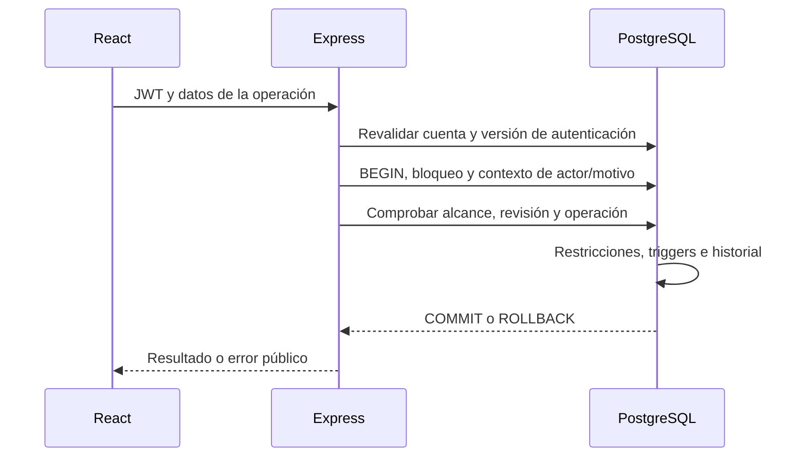

# Funcionamiento del sistema

[Inicio](../README.md) · [Estructura](ESTRUCTURA.md) · [Base de datos](../database/README.md)

## Uso desde la interfaz

1. **Entrar.** Iniciar sesión con una cuenta activa. El menú muestra las opciones de su perfil.
   Las cuentas se crean desde administración; no hay inscripción pública de usuarios.
2. **Registrar.** Abrir Documentos y el formulario de registro. Elegir tipo y clasificación
   (Recibido o Emitido), escribir el asunto y completar los datos necesarios. El sistema asigna
   el código; la persona no necesita calcular el siguiente número. Según el perfil se indica
   ubicación, conservación en Mesa de Partes, envío a Dirección o destino de delegación.
3. **Consultar.** Buscar en el listado y abrir el detalle. Sus acciones dependen de la cuenta,
   la situación y los permisos devueltos por el servidor. El PDF puede adjuntarse al registrar
   o después, si la cuenta tiene permiso. Un fallo de carga del PDF no borra el registro creado.
4. **Delegar.** Usar la acción disponible en el documento o indicar destino al registrarlo.
   Seleccionar una cuenta registrada y, cuando corresponda, su oficina. La confirmación deja
   constancia del destino y conserva la autoría. Un nombre escrito manualmente sirve como
   constancia, pero no permite que esa persona entre al sistema sin cuenta.
5. **Consultar como destinatario.** Entrar con la cuenta elegida como destino, abrir Documentos
   y localizar el registro identificado como «Delegado a mí». Al abrirlo se pueden consultar
   los datos y el PDF disponible. Puede registrar acciones propias y delegar nuevamente; no puede corregir el original, anular, cambiar ubicación,
   gestionar el PDF principal. El recorrido de atención sí está disponible. El historial y la auditoría no se entregan por ese acceso.

## Términos usados en esta guía

| Término | Significado en este proyecto |
|---|---|
| API | Servidor que recibe solicitudes de la interfaz, comprueba permisos y devuelve resultados |
| Ámbito | Conjunto de registros propio de una cuenta o compartido por Dirección y Secretaría |
| JWT o comprobante de sesión | Texto firmado que la interfaz envía para identificar la sesión |
| Transacción | Grupo de cambios que se confirma completo o se deshace si hay un error |
| Revisión | Versión del registro; evita guardar encima de un cambio más reciente |
| Trigger o disparador | Regla que PostgreSQL ejecuta automáticamente cuando cambian datos |
| R2 | Almacenamiento privado de los archivos PDF; la base guarda sus referencias |

## Recorrido de una operación

`backend/src/shared/documental/nucleo.ts` concentra permisos y transacciones. Los IDs bigint viajan como cadenas para conservar precisión en JavaScript.

## Identidad y perfiles

El login acepta nombre de usuario o correo. Verifica contraseña mediante scrypt y emite JWT. Cada petición vuelve a consultar actividad y versión de autenticación; cambios de contraseña o actividad revocan las sesiones afectadas. La interfaz diferencia sesión vencida, error de red y falta de autorización.

| Perfil | Alcance principal |
|---|---|
| Superadministrador | Administración y lectura global, incluidos anulados; no obtiene escritura documental por esa lectura |
| Administrador | Configuración de cuentas y oficinas, sin detalle ni PDF documental |
| Dirección | Registro compartido, decisiones de Dirección y consulta institucional; requiere oficina para operar |
| Secretaría | Registro compartido, Mesa de Partes, lectura de ese ámbito, historial de su oficina y delegaciones recibidas; sin consulta general de ámbitos personales |
| Usuario | Registro personal; lectura propia, delegaciones recibidas e historia de oficina conforme al relevo |

Los códigos de rol son estables; cambiar su nombre visible no cambia permisos. Las funciones SQL `documento_consultable`, `documento_consultable_con_delegacion` y `documento_delegado_por` determinan lectura. `permisos()` calcula acciones; servicios y triggers las verifican al modificar.

## Registro y situaciones

`RECIBIDO` y `EMITIDO` son clasificaciones, independientes de la situación. El alta asigna correlativo por ámbito, tipo y año y conserva el nombre del tipo. Correlativos y auditoría participan en la transacción.

Dirección inicia en `PENDIENTE_DIRECCION`; Secretaría elige Mesa de Partes o envío a Dirección; Usuario inicia en `PERSONAL`. Existen también `GUARDADO_DIRECCION`, `DELEGADO` y `ANULADO`. «En mi oficina», «Delegado por mí» y «Delegado a mí» son etiquetas calculadas para la cuenta que consulta.

El alta puede incluir delegación inmediata, confirmada en la misma transacción. El PDF opcional se carga después: si falla, el documento permanece y admite reintento. Corrección y anulación comparan `revision` y requieren motivo; una revisión anterior produce HTTP 409.

## Delegación y destinatario

Se registra una constancia por cada delegación, con actor, persona indicada, fecha e indicaciones opcionales. El buscador valida cuenta y oficina; también admite destino manual. Texto libre no crea cuentas ni acceso autenticado.

La cuenta destinataria obtiene lectura del registro original y su PDF, y puede agregar acciones, corregir sus propias acciones y realizar nuevas delegaciones. Todos los destinatarios conservan acceso a los mismos antecedentes y acontecimientos posteriores, incluso después de delegar nuevamente. La clasificación «Delegado a mí» se mantiene para esos destinatarios. Recibir una delegación no permite corregir datos originales, anular, cambiar ubicación ni gestionar el PDF principal. El registro conserva autor y ámbito.

El autor puede conservar carga y reemplazo de PDF tras delegar según su permiso; eliminar se calcula por separado. Secretaría no puede anular después de una decisión de Dirección que haya guardado el documento o delegado por otro actor.

## Ubicaciones y relevo

Las unidades pertenecen a una cuenta y oficina y forman un árbol sin ciclos. La selección distingue estante y archivador. La ubicación guarda ruta histórica y vigencia; renombrar el catálogo no reescribe la historia.

El relevo cierra el periodo saliente y abre el entrante. Permite consulta de documentos anteriores, sin edición ni transferencia de estantes personales. Los triggers protegen los documentos de periodos cerrados.

## PDF

Se aceptan PDF sin cifrado de hasta **15 MiB**. Preparar una carga devuelve una URL temporal R2; el navegador envía el archivo al bucket privado. Confirmar comprueba tamaño, tipo, estructura y revisión, copia condicionalmente al objeto definitivo y actualiza metadatos. SQL guarda referencias, no binarios.

Abrir o descargar revalida lectura. Para acceso ordinario emite una URL GET de corta duración;
para el destinatario delegado la API obtiene el contenido, vuelve a comprobar permiso y revisión
y devuelve los bytes codificados en la respuesta. El visor usa PDF.js. Sustitución y borrado dejan tareas durables de limpieza. Anular programa retención de **14 días**; el mantenimiento confirma la ausencia del objeto antes de finalizar. Reintenta al arrancar y cada cinco minutos mientras el backend esté activo. Las pruebas sustituyen R2 por un adaptador controlado.

## Historial, relaciones y exportación

El historial combina registro, corrección, anulación, delegación, ubicación y PDF. Auditoría conserva actor, motivo y cambios públicos sin hashes. Los grupos de documentos relacionados filtran cada integrante y no revelan registros inaccesibles mediante enlaces.

Excel selecciona año y mes y aplica el alcance autorizado, hasta **10 000** filas. El archivo temporal se retira al terminar o cancelar la descarga. Exportar no amplía los permisos del perfil.

## Administración

Permite gestionar cuentas, actividad, claves, oficinas y nombres visibles de roles. Los tipos pertenecen a ámbitos; las ubicaciones pertenecen a cuentas con oficina. El Superadministrador único está protegido frente a duplicación y desactivación. Zod valida contratos; errores públicos distinguen entrada inválida, sesión, permisos y conflictos sin exponer detalles SQL o del almacenamiento.

## Archivos que participan en los flujos

Las rutas de esta sección parten de la raíz del repositorio. El [mapa de archivos](ESTRUCTURA.md)
enlaza cada fuente y explica su propósito.

### Inicio de sesión

`frontend/src/features/auth/pages/LoginPage.tsx` recoge usuario o correo y contraseña.
`auth.api.ts` envía la solicitud; `AuthSession.ts` conserva el estado y el vencimiento.
En el servidor, `modules/auth/auth.routes.ts` limita intentos, `auth.controller.ts` valida
la entrada y `auth.service.ts` usa el repositorio y `shared/security/password.ts` para
comprobar la contraseña. `jwt.ts` firma una sesión de una hora. Las peticiones siguientes
pasan por `auth.middleware.ts`, que vuelve a comprobar actividad y versión de la cuenta.

### Registrar, delegar y consultar como destinatario

1. `DocumentoFormularioPage.tsx` obtiene tipos y opciones mediante `api/documental.ts`.
   `FormularioDocumento.tsx` recoge clasificación, asunto, remitente y observaciones.
   `DestinoDocumental.tsx` busca cuentas a través de `buscarDestinatarios`;
   no ofrece roles administrativos y el servidor vuelve a comprobar el destino al guardar.
2. `documentos.routes.ts` valida el alta con `documental.schema.ts` y llama a
   `registrar` en `documentos.escrituras.ts`. `nucleo.ts` inicia una transacción,
   comprueba la cuenta y fija el actor que utilizarán los triggers SQL.
3. `asignar_codigo_documental.sql` reserva correlativo y conserva autor, tipo y ámbito.
   Si hay destino inicial, `insertarDelegacion` guarda la constancia en la misma transacción.
   `validar_delegacion.sql` comprueba situación y autor; `aplicar_delegacion.sql`
   cierra la ubicación vigente, cambia la situación y registra el hecho en la auditoría.
4. Para delegar después, `AccionesDocumento.tsx` manda la revisión visible. El servidor
   rechaza una revisión antigua antes de guardar; admite delegaciones sucesivas conservando las constancias anteriores.
5. La cuenta destinataria abre `DocumentosListaPage.tsx` y `DocumentoDetallePage.tsx`.
   `documentos.consultas.ts` aplica `lecturaSQL` antes de contar, filtrar y devolver filas.
   `documento_delegado_por.sql` reconoce el destino registrado y activo.
   `permisos()` mantiene bloqueada la escritura original y habilita atención propia y delegación sucesiva.
   El historial y la auditoría devuelven colecciones vacías al destinatario.
6. `ArchivoPdf.tsx` consulta el adjunto mediante `pdf.api.ts` y `pdf.routes.ts`.
   `pdf.documental.ts` comprueba el mismo alcance y la revisión antes de entregar su contenido.
   La cuenta no recibe edición del original, eliminación ni ubicación; sí puede delegar nuevamente y registrar atención propia.

### Ubicación e historial

`UbicacionesPage.tsx` administra lugares propios mediante `configuracion.operaciones.ts`.
`SelectorUbicacion.tsx` pide sugerencias y búsqueda al servidor; no descarga todo el catálogo.
`ubicar` comprueba unidad, oficina y cadena de antecesores activos dentro de la transacción.
`validar_ubicacion.sql` conserva la ruta y oficina en la constancia; `aplicar_ubicacion.sql`
registra el evento. `HistorialDocumento.tsx` y `AuditoriaDocumento.tsx` presentan únicamente
los cambios permitidos, preparados por `auditoria.documental.ts` e `historialDocumental.ts`.

### Excel, administración y panel

`ExportarDocumentos.tsx` solicita el mes. `exportacion.controller.ts` entrega la descarga;
`exportacion.repository.ts` aplica permisos y límite; `exportacion.excel.ts` crea celdas
y fechas de Perú y elimina temporales al terminar. Los filtros de fecha del registro también
usan el calendario de Perú; las fechas generales de pantalla usan la zona del navegador.

Las páginas de `features/usuarios` llaman a `administracion.routes.ts`.
`administracion.operaciones.ts` gestiona cuentas, `configuracion.operaciones.ts` catálogos
y `relevo.operaciones.ts` el responsable de oficina. Cada cambio aplica autorización
y auditoría; cambiar una contraseña o actividad invalida sesiones anteriores.

`DashboardPage.tsx` recibe los agregados de `dashboard.documental.ts`.
`GraficosDashboard.tsx` elige el alcance, `GraficosDistribucion.tsx` presenta distribuciones
y barras, y `SerieMensual.tsx` muestra meses. Las tablas utilizan las mismas cifras del gráfico.

## Acciones realizadas y recorrido

Cada destinatario registrado agrega acciones independientes con descripción obligatoria y un PDF opcional de hasta 15 MiB. Usuario, oficina si existe y fecha/hora son automáticos. Solo el autor corrige su acción, con control de revisión; la corrección no crea otra acción y conserva antes/después en la auditoría existente.

Dirección y los destinatarios consultan un recorrido cronológico con registro inicial, delegaciones, acciones y correcciones diferenciadas. Los PDF de las acciones se abren con el visor existente mediante lectura autorizada. Esos archivos son independientes del PDF principal. La preparación durable, validación R2 y cola de limpieza evitan vínculos a archivos no confirmados y permiten recuperar fallos.

El buscador de documento de origen incluye exclusivamente registros propios y delegados al usuario, aunque haya vuelto a delegarlos. Cada relacionado conserva sus permisos; el origen directo y el origen del grupo se distinguen visualmente cuando son visibles. Registrar un relacionado no altera el origen ni agrega eventos al recorrido.

No se añaden estados de atención, cierre, recepción física, aceptación ni rechazo. Las instalaciones existentes necesitan la migración 016 antes de iniciar la API de esta versión; véase [Base de datos](../database/README.md).
